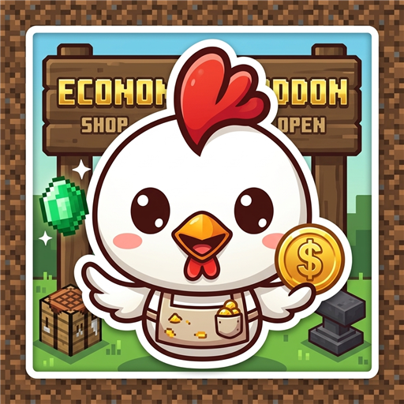
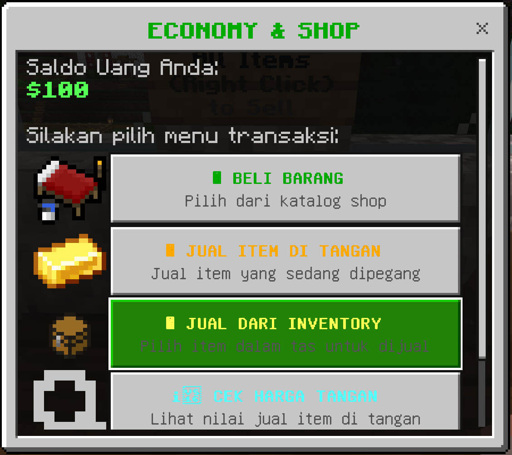
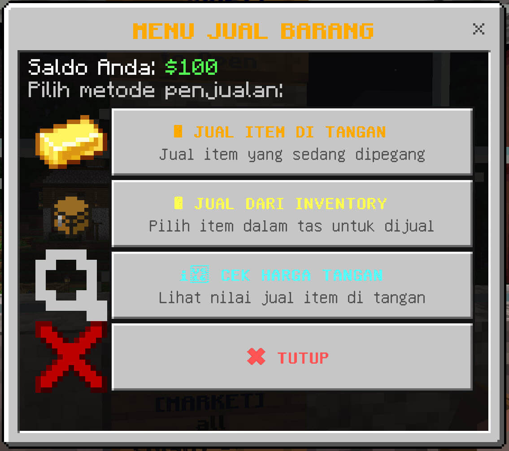
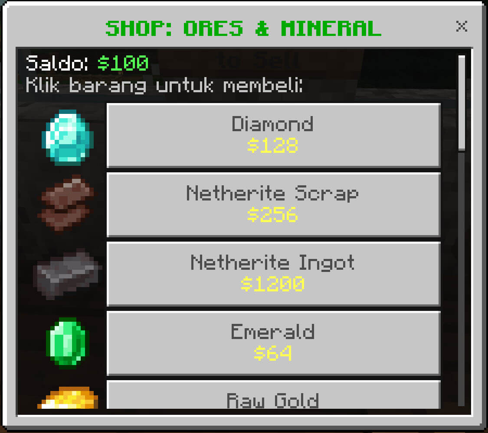

  

<h1 align="center">Petek Economy & Shop (Single Player Edition)</h1>

  <em>Addon Bedrock Behavior Pack mandiri yang dioptimalkan khusus untuk kenyamanan dan keaslian bermain Single Player Survival dengan sistem Toko Fisik (Sign Shop) dan Ekonomi Terkalibrasi.</em>

> **Keunggulan:**
>
> - **Tanpa Beta APIs & Tanpa Experiments:** Menggunakan Script API versi Stable (`@minecraft/server: 1.14.0+` dan `@minecraft/server-ui: 1.3.0`), sehingga world survival vanilla tanpa eksperimen dapat langsung memainkannya.
> - **Sistem Toko Fisik Realistis (Imersif):** Pemain tidak bisa belanja dari antah berantah (misal di goa atau Nether), melainkan harus membangun kios/gedung toko di base lalu memasang papan Sign.
> - **Ekonomi Seimbang (Anti-Exploit):** Dirancang sistematis berdasarkan rasio galian tambang. Bebas dari eksploitasi panen kayu/pertanian, dan menghargai proses peleburan (smelting).

---

## 📸 Screenshot & Preview

    
    
  

---

## 🏬 Cara Membuat Toko Fisik (Sign Shop)

Cukup pasang Sign (kayu apa saja) di dinding atau tiang toko kamu, lalu tulis teks berikut:

### 1. Papan Pasar Utama (`[MARKET]`) — Membuka GUI Shop

Digunakan untuk membuka katalog belanja seluruh barang atau per kategori:

- **Tulis di Sign:**
  - Baris 1: `[MARKET]`
  - Baris 2: `All` _(atau nama kategori: `Ores`, `Blocks`, `Wood`, `Food`, `Nature`, `Drops`)_
- **Cara Mengaktifkan:**
  - Klik kanan sign tersebut. Sign akan otomatis berubah warna biru (`§1§l[MARKET]`) dan membuka menu GUI!

---

### 2. Papan Jual Barang (`[SELL]`) — Membuka Menu Jual

Digunakan untuk menjual hasil panen, tambang, atau barang buruan:

- **Tulis di Sign:**
  - Baris 1: `[SELL]`
- **Cara Mengaktifkan:**
  - Klik kanan sign. Sign akan berubah warna oranye (`§6§l[SELL]`).
  - Klik kanan berikutnya akan membuka menu untuk menjual item di tangan atau memilih item dari dalam tas inventory.

---

### 3. Papan Beli Cepat (`[SHOP]`) — 1 Klik Langsung Beli Item Tertentu

Cocok untuk membuat etalase rak khusus barang tertentu:

- **Tulis di Sign:**
  - Baris 1: `[SHOP]`
  - Baris 2: `Harga` _(contoh: `100`)_
  - Baris 3: `Jumlah` _(contoh: `16`)_
  - Baris 4: `Nama Item` atau tulis `hand` sambil memegang itemnya di tangan utama
- **Cara Mengaktifkan:**
  - Klik kanan sign. Sign akan otomatis divalidasi menjadi etalase resmi bertuliskan hijau & harga item.
  - Setiap klik kanan berikutnya akan memotong saldo dan memberikan item ke inventory!

---

## ⚖️ Pedoman Rasio Ekonomi (Balancing)

Ekonomi mod ini menggunakan sistem rasio matematis yang adil:

1. **Patokan Dasar (Anchor):**

   - `1 Cobblestone` = **Beli $2 | Jual $1** ($64/stack).
   - `1 Raw Iron` = **8 Cobblestone** = **Beli $16 | Jual $9**.
   - `1 Diamond` = **8 Raw Iron** = **64 Cobblestone (1 stack)** = **Beli $128 | Jual $76**.
   - `1 Netherite Scrap` = **2 Diamond** = **Beli $256 | Jual $153**.
   - `1 Netherite Ingot` = **Beli $1,200 | Jual $720** (sesuai resep 4 Scrap + 4 Gold Ingot).

2. **Bebas Sampah Galian Tambang (Mining Waste):**

   - _Cobblestone, Cobbled Deepslate, Stone, Deepslate, Granite, Diorite, Andesite, Tuff, Calcite, Netherrack, Basalt, Blackstone, Dirt, Sand, Gravel_ semuanya laku dijual seharga **$1 / pcs** ($64 per stack penuh).

3. **Margin Profit Smelting (Peleburan Ore):**

   - Membakar ore di furnace memberikan keuntungan ekstra saat dijual:
     - Raw Copper ($4) ➔ Copper Ingot (**$6**) _(Profit +$2)_
     - Raw Iron ($9) ➔ Iron Ingot (**$12**) _(Profit +$3)_
     - Raw Gold ($19) ➔ Gold Ingot (**$22**) _(Profit +$3)_

4. **Kayu & Pertanian (Anti-Exploit):**
   - Log Kayu dihargai **Beli $4 | Jual $2** (rasio 2:1 terhadap Cobble, karena 1 log = 4 planks).
   - Hasil panen massal (Wortel, Kentang, Gandum, Melon slice) dihargai **Beli $2 | Jual $1**.

---

## ⌨️ Perintah Bawaan (/scriptevent) — 100% Non-Experimental

Karena tidak menggunakan experimental, gunakan perintah resmi `/scriptevent` di kolom chat/console:

| Perintah (/scriptevent)               | Fungsi                                                                       |
| :------------------------------------ | :--------------------------------------------------------------------------- |
| `/scriptevent shop:bal`               | Mengecek saldo uang saat ini                                                 |
| `/scriptevent shop:price`             | Mengecek estimasi harga jual item di tangan                                  |
| `/scriptevent shop:help`              | Menampilkan panduan ringkas pembuatan toko sign di chat                      |
| `/scriptevent shop:addmoney <jumlah>` | Menambahkan uang sendiri (Cheat SP, misal: `/scriptevent shop:addmoney 500`) |
| `/scriptevent shop:setmoney <jumlah>` | Menyetel saldo sendiri (misal: `/scriptevent shop:setmoney 2000`)            |

_(Catatan: Belanja dan jual barang hanya bisa dilakukan dengan datang langsung ke toko fisik dan mengeklik Sign `[MARKET]` atau `[SELL]`)_

---

## ⚙️ Kustomisasi (`scripts/config.js`)

Semua konfigurasi dapat diubah di file [`scripts/config.js`](file:///c:/Users/User/AppData/Roaming/Minecraft%20Bedrock/Users/Shared/games/com.mojang/development_behavior_packs/petek_mc_economy_shop/scripts/config.js):

- `ALLOW_GLOBAL_SHOP_ACCESS`:
  - `false` _(Default)_: Pemain wajib datang ke toko fisik dan menggunakan Sign.
  - `true`: Mengizinkan pemain membuka shop di mana saja via klik kanan Emerald/Stick atau ketik `!shop`.
- `ALLOW_GLOBAL_SELL_COMMAND`:
  - `false` _(Default)_: Pemain wajib jual barang lewat Sign `[SELL]` atau `[MARKET]`.
  - `true`: Mengizinkan pemain jual item di mana saja lewat command `!sell`.
- `SELL_PRICE_MULTIPLIER`: Rasio harga jual terhadap harga beli (default: `0.6` / 60%).
- `ENABLE_STARTER_MONEY`: Berikan modal awal pemain baru (`true` / `false`).
- `STARTER_MONEY_AMOUNT`: Jumlah modal awal (default: `$1,000`).
- `ENABLE_CHEAT_COMMANDS`: Mengaktifkan/menonaktifkan command `!addmoney` dan `!setmoney`.

---

## 📦 Cara Transfer / Ekspor ke Teman (.mcpack)

Jika ingin membagikan addon ini ke teman atau memindahkan ke HP:

1. Masuk ke dalam folder `petek_mc_economy_shop`.
2. Blok seluruh isinya (`manifest.json`, folder `scripts`, `README.md`).
3. Klik kanan ➔ _Compress to ZIP_.
4. Ganti ekstensi file dari `.zip` menjadi `.mcpack` (contoh: `Petek_Economy_Shop.mcpack`).
5. Kirim file tersebut. Teman cukup klik 2x (PC) atau tap file-nya (HP) untuk otomatis memasangnya ke Minecraft!

---

## 📋 Persyaratan

- **Minecraft Bedrock Edition:** Versi `1.21.30` atau lebih baru.
- **Eksperimen World:** **TIDAK PERLU** mengaktifkan eksperimen apa pun ("Beta APIs" TIDAK diperlukan).
