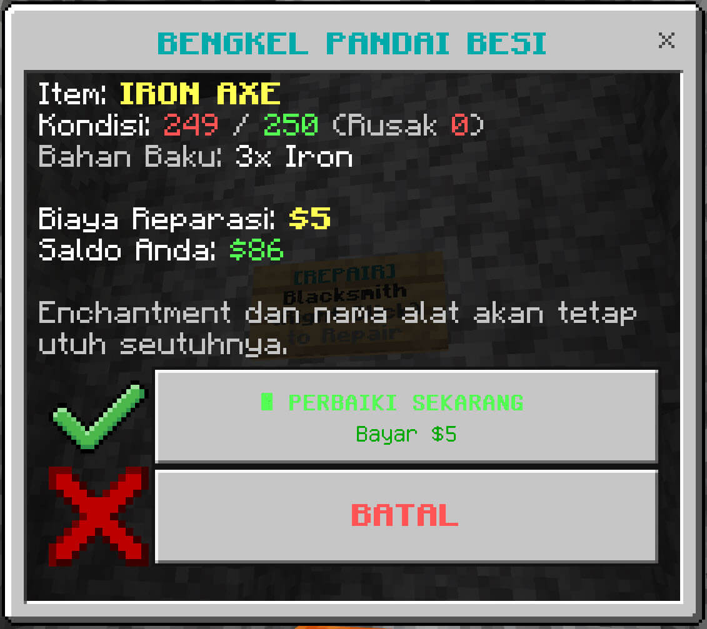

<p align="center">
  
</p>

<h1 align="center">Petek Economy & Shop (Single Player Edition)</h1>

<p align="center">
  <em>Addon Bedrock Behavior Pack mandiri yang dioptimalkan khusus untuk kenyamanan dan keaslian bermain Single Player Survival dengan sistem Toko Fisik (Sign Shop) dan Ekonomi Terkalibrasi.</em>
</p>

> **Keunggulan:**
>
> - **Tanpa Beta APIs & Tanpa Experiments:** Menggunakan Script API versi Stable (`@minecraft/server: 1.14.0+` dan `@minecraft/server-ui: 1.3.0`), sehingga world survival vanilla tanpa eksperimen dapat langsung memainkannya.
> - **Sistem Toko Fisik Realistis (Imersif):** Pemain tidak bisa belanja dari antah berantah (misal di goa atau Nether), melainkan harus membangun kios/gedung toko di base lalu memasang papan Sign.
> - **Ekonomi Seimbang (Anti-Exploit):** Dirancang sistematis berdasarkan rasio galian tambang. Bebas dari eksploitasi panen kayu/pertanian, dan menghargai proses peleburan (smelting).

---

## 📸 Screenshot & Preview

<p align="center">
  <br><br>
  <br><br>
  <br><br>
  
</p>

---

## 🏬 Cara Membuat Toko Fisik (Sign Shop)

Cukup pasang Sign (kayu apa saja) di dinding atau tiang toko kamu, lalu tulis teks berikut:

### 1. Papan Pasar Utama (`[MARKET]`) — Membuka GUI Shop

Digunakan untuk membuka katalog belanja seluruh barang atau per kategori:

- **Tulis di Sign:**
  - Baris 1: `[MARKET]`
  - Baris 2: `All` _(atau nama kategori: `Ores`, `Blocks`, `Wood`, `Food`, `Nature`, `Drops`)_
- **Cara Mengaktifkan:**
  - Klik kanan sign tersebut. Sign akan otomatis berubah warna biru (`§1§l[MARKET]`) dan membuka menu GUI!

---

### 2. Papan Jual Barang (`[SELL]`) — Membuka Menu Jual

Digunakan untuk menjual hasil panen, tambang, atau barang buruan:

- **Tulis di Sign:**
  - Baris 1: `[SELL]`
- **Cara Mengaktifkan:**
  - Klik kanan sign. Sign akan berubah warna oranye (`§6§l[SELL]`).
  - Klik kanan berikutnya akan membuka menu untuk menjual item di tangan atau memilih item dari dalam tas inventory.

---

### 3. Papan Beli Cepat (`[SHOP]`) — 1 Klik Langsung Beli Item Tertentu

Cocok untuk membuat etalase rak khusus barang tertentu:

- **Tulis di Sign:**
  - Baris 1: `[SHOP]`
  - Baris 2: `Harga` _(contoh: `100`)_
  - Baris 3: `Jumlah` _(contoh: `16`)_
  - Baris 4: `Nama Item` atau tulis `hand` sambil memegang itemnya di tangan utama
- **Cara Mengaktifkan:**
  - Klik kanan sign. Sign akan otomatis divalidasi menjadi etalase resmi bertuliskan hijau & harga item.
  - Setiap klik kanan berikutnya akan memotong saldo dan memberikan item ke inventory!

---

### 4. Papan Bengkel Pandai Besi (`[REPAIR]`) — Reparasi Alat & Armor Bebas Anvil Cap

Digunakan untuk memperbaiki alat, senjata, atau armor rusak tanpa batasan pinalti Anvil (_Too Expensive_):

- **Tulis di Sign:**
  - Baris 1: `[REPAIR]`
- **Cara Mengaktifkan:**
  - Klik kanan sign sambil memegang alat yang rusak di tangan utama.
  - Sign akan otomatis berganti warna cyan (`§3§l[REPAIR]`) dan membuka pop-up rincian biaya.
  - **Kalkulasi Dinamis & Adil:** Biaya dihitung berdasarkan persentase kerusakan ($damage\%$) dan harga bahan aslinya (Netherite/Diamond/Iron/dsb.), dengan pembulatan bilangan bulat bersih.
  - Durability alat kembali penuh (100%), dan seluruh **Enchantment tetap utuh seutuhnya**.

---

## ⚖️ Pedoman Rasio Ekonomi (Balancing)

Ekonomi mod ini menggunakan sistem rasio matematis yang adil:

1. **Patokan Dasar (Anchor):**

   - `1 Cobblestone` = **Beli $2 | Jual $1** ($64/stack).
   - `1 Raw Iron` = **8 Cobblestone** = **Beli $16 | Jual $9**.
   - `1 Diamond` = **8 Raw Iron** = **64 Cobblestone (1 stack)** = **Beli $128 | Jual $76**.
   - `1 Netherite Scrap` = **2 Diamond** = **Beli $256 | Jual $153**.
   - `1 Netherite Ingot` = **Beli $1,200 | Jual $720** (sesuai resep 4 Scrap + 4 Gold Ingot).

2. **Bebas Sampah Galian Tambang (Mining Waste):**

   - _Cobblestone, Cobbled Deepslate, Stone, Deepslate, Granite, Diorite, Andesite, Tuff, Calcite, Netherrack, Basalt, Blackstone, Dirt, Sand, Gravel_ semuanya laku dijual seharga **$1 / pcs** ($64 per stack penuh).

3. **Margin Profit Smelting (Peleburan Ore):**

   - Membakar ore di furnace memberikan keuntungan ekstra saat dijual:
     - Raw Copper ($4) ➔ Copper Ingot (**$6**) _(Profit +$2)_
     - Raw Iron ($9) ➔ Iron Ingot (**$12**) _(Profit +$3)_
     - Raw Gold ($19) ➔ Gold Ingot (**$22**) _(Profit +$3)_

4. **Kayu & Pertanian (Anti-Exploit):**
   - Log Kayu dihargai **Beli $4 | Jual $2** (rasio 2:1 terhadap Cobble, karena 1 log = 4 planks).
   - Hasil panen massal (Wortel, Kentang, Gandum, Melon slice) dihargai **Beli $2 | Jual $1**.

---

## ⌨️ Perintah Bawaan (/scriptevent) — 100% Non-Experimental

Karena tidak menggunakan experimental, gunakan perintah resmi `/scriptevent` di kolom chat/console:

| Perintah (/scriptevent)               | Fungsi                                                                       |
| :------------------------------------ | :--------------------------------------------------------------------------- |
| `/scriptevent shop:bal`               | Mengecek saldo uang saat ini                                                 |
| `/scriptevent shop:price`             | Mengecek estimasi harga jual item di tangan                                  |
| `/scriptevent shop:repair`            | Membuka menu reparasi untuk alat/armor di tangan (Bengkel Tukang Besi)       |
| `/scriptevent shop:help`              | Menampilkan panduan ringkas pembuatan toko sign di chat                      |
| `/scriptevent shop:addmoney <jumlah>` | Menambahkan uang sendiri (Cheat SP, misal: `/scriptevent shop:addmoney 500`) |
| `/scriptevent shop:setmoney <jumlah>` | Menyetel saldo sendiri (misal: `/scriptevent shop:setmoney 2000`)            |

_(Catatan: Belanja dan jual barang hanya bisa dilakukan dengan datang langsung ke toko fisik dan mengeklik Sign `[MARKET]` atau `[SELL]`)_

---

## ⚙️ Kustomisasi Konfigurasi (`scripts/config.js`)

Semua konfigurasi sistem dapat diubah di file [`scripts/config.js`](scripts/config.js):

- `ALLOW_GLOBAL_SHOP_ACCESS`:
  - `false` _(Default)_: Pemain wajib datang ke toko fisik dan menggunakan Sign.
  - `true`: Mengizinkan pemain membuka shop di mana saja via klik kanan Emerald/Stick atau ketik `!shop`.
- `ALLOW_GLOBAL_SELL_COMMAND`:
  - `false` _(Default)_: Pemain wajib jual barang lewat Sign `[SELL]` atau `[MARKET]`.
  - `true`: Mengizinkan pemain jual item di mana saja lewat command `!sell`.
- `SELL_PRICE_MULTIPLIER`: Rasio harga jual terhadap harga beli (default: `0.6` / 60%).
- `ENABLE_STARTER_MONEY`: Berikan modal awal pemain baru (`true` / `false`).
- `STARTER_MONEY_AMOUNT`: Jumlah modal awal (default: `$1,000`).
- `ENABLE_CHEAT_COMMANDS`: Mengaktifkan/menonaktifkan command `!addmoney` dan `!setmoney`.
- `ENABLE_BLACKSMITH_REPAIR`:
  - `true` _(Default)_: Mengaktifkan bengkel reparasi tukang besi via Sign `[REPAIR]` atau `/scriptevent shop:repair`.
  - `false`: Menonaktifkan fitur reparasi tukang besi.
- `REPAIR_PRICE_DISCOUNT`: Diskon biaya servis dibanding harga material baru (default: `0.6` / 60%).
- `REPAIR_SERVICE_FEE`: Ongkos jasa tempa flat (default: `$5`).

---

## 🏷️ Kustomisasi Daftar Item & Harga Toko (`scripts/shop/shop_items.js`)

Jika ingin **mengubah harga**, **menambah item baru**, atau **menghapus item** dari katalog toko:

### 1. File Yang Diubah:
- **Daftar Barang & Harga Beli Dasar:** [`scripts/shop/shop_items.js`](scripts/shop/shop_items.js) pada array `SERVER_SHOP_ITEMS`.
- **Rasio Harga Jual:** [`scripts/config.js`](scripts/config.js) pada `SELL_PRICE_MULTIPLIER` (otomatis mengalikan harga beli, misal `0.6` = 60%).

### 2. Struktur Objek Item:
Setiap item di dalam array `SERVER_SHOP_ITEMS` memiliki format seperti berikut:

```javascript
{
  name: "Nama Item",                  // Nama yang tampil di menu UI Toko
  id: "minecraft:nama_item",          // Identifier resmi item Minecraft
  price: 10,                          // Harga beli (angka integer)
  category: "Nature",                 // Kategori: Ores | Blocks | Wood | Food | Nature | Drops
  texture: "textures/items/nama_item" // Path tekstur icon di Bedrock RP
}
```

> **Catatan Harga Jual:** Pemain akan menjual barang dengan harga:
> $$\text{Harga Jual} = \max(1, \lfloor \text{price} \times \text{SELL\_PRICE\_MULTIPLIER} \rfloor)$$
> Jadi Anda cukup menentukan `price` (harga beli), dan harga jualnya akan dikalkulasi otomatis secara konsisten.

### 3. Contoh: Menambah Item Baru (Misal: Jamur)
Buka [`scripts/shop/shop_items.js`](scripts/shop/shop_items.js) dan tambahkan objek baru ke dalam array `SERVER_SHOP_ITEMS`:

```javascript
// Contoh menambah Brown Mushroom ke kategori Nature
{
  name: "Brown Mushroom",
  id: "minecraft:brown_mushroom",
  price: 4,                           // Beli $4 | Jual otomatis jadi $2 (4 x 0.6)
  category: "Nature",
  texture: "textures/blocks/mushroom_brown",
},

// Contoh menambah Mushroom Stew ke kategori Food
{
  name: "Mushroom Stew",
  id: "minecraft:mushroom_stew",
  price: 8,                           // Beli $8 | Jual otomatis jadi $4 (8 x 0.6)
  category: "Food",
  texture: "textures/items/mushroom_stew",
},
```

### 4. Contoh: Mengubah Harga Item yang Sudah Ada
Cari nama atau ID item di [`scripts/shop/shop_items.js`](scripts/shop/shop_items.js) (misal `minecraft:diamond`), lalu ubah nilai properti `price`:

```javascript
// Sebelum:
{
  name: "Diamond",
  id: "minecraft:diamond",
  price: 128,
  ...
}

// Sesudah (misal ingin dinaikkan):
{
  name: "Diamond",
  id: "minecraft:diamond",
  price: 150,
  ...
}
```

---

## 📦 Cara Ekspor, Pasang, dan Aktifkan di World (.mcpack)

Untuk membagikan addon ini ke teman atau memindahkannya ke perangkat lain (PC / Android / iOS), Anda dapat mengemasnya menjadi file installer **`.mcpack`** yang mendukung instalasi otomatis 1-klik:

### 1. Membuat File Installer (`.mcpack`):
1. Buka folder `petek_mc_economy_shop`.
2. Pilih file-file penting (`manifest.json`, folder `scripts`, `pack_icon.png`).
3. Klik kanan ➔ **Compress to ZIP**.
4. Ubah nama file dari `.zip` menjadi `.mcpack` (contoh: `Petek_Economy_Shop.mcpack`).

### 2. Memasang ke Minecraft (Sisi Pemain / Teman):
- **Windows (PC):** Cukup **dobel-klik (klik 2x)** file `Petek_Economy_Shop.mcpack`.
- **Android / iOS (HP):** Tap file tersebut lalu pilih buka dengan (**Open with Minecraft**).
- Minecraft akan otomatis terbuka dan memunculkan notifikasi di atas layar:
  > *“Import started...”* ➔ *“Successfully imported Petek Economy & Shop”*

### 3. Mengaktifkan di World Survival:
1. Buka Minecraft ➔ klik ikon **Pensil / Edit** pada World yang diinginkan (atau saat bikin World baru).
2. Di menu sebelah kiri, scroll ke bawah ke bagian **Behavior Packs**.
3. Buka tab **Available** (Tersedia) ➔ temukan **Petek Economy & Shop**.
4. Klik tombol **Activate**.
5. Masuk ke dalam game dan nikmati sistem tokonya!

---

## 📋 Persyaratan

- **Minecraft Bedrock Edition:** Versi `1.21.30` atau lebih baru.
- **Eksperimen World:** **TIDAK PERLU** mengaktifkan eksperimen apa pun ("Beta APIs" TIDAK diperlukan).
